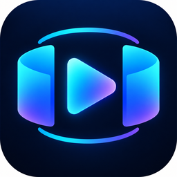
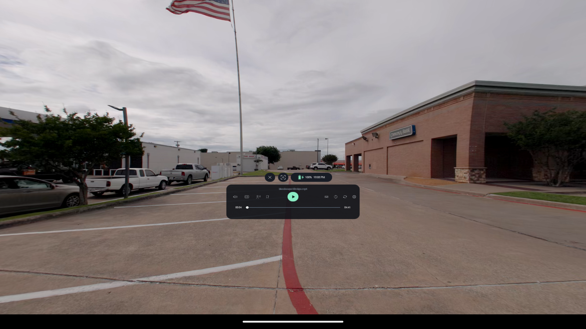
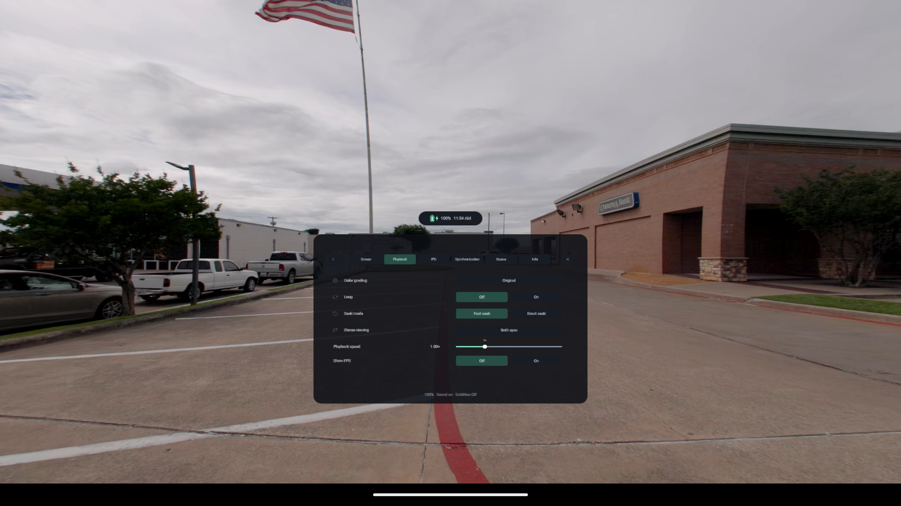
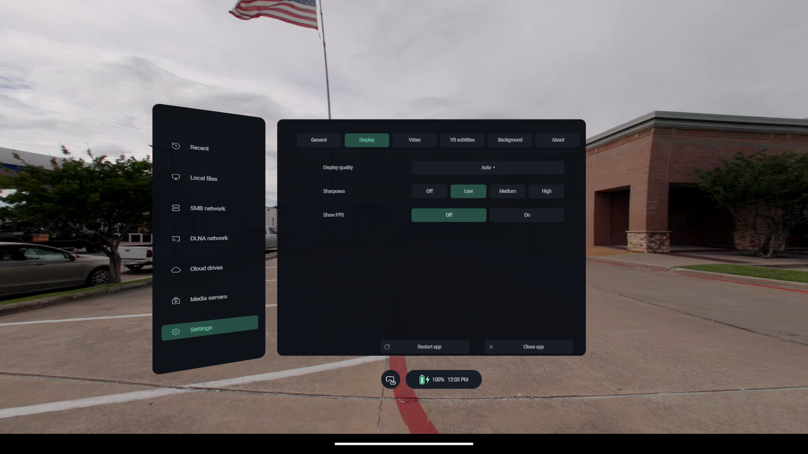

# Immivio

### Open Spatial Media Player

**VR180 · VR360 · 3D · Spatial Video · Photos**

An open-source spatial media player for standalone XR headsets.

Watch your own videos and photos on Meta Quest, PICO, or a compatible Android OpenXR headset. Choose a virtual screen or an immersive projection, connect your media library, and keep playback controls within reach.

[Website](https://northboundwisdom.github.io/immivio/) · [Releases](https://github.com/NorthBoundWisdom/immivio/releases) · [Development builds](https://github.com/NorthBoundWisdom/immivio/actions/workflows/android-release.yml) · [User guide](https://northboundwisdom.github.io/immivio/guide/) · [中文官网与使用指南](https://northboundwisdom.github.io/immivio/zh/)

Immivio continues development of [zerochocobo/Thru3D-Media-Player](https://github.com/zerochocobo/Thru3D-Media-Player). **Version 0.6.0 is the last shared baseline. From that point, this project follows its own development and release path, independently maintained by NorthBoundWisdom.** The original source history, attribution and GPL-3.0 license are preserved.

## Your media, all around you

*Actual Android emulator capture using `blandscape-60mbps.mp4`, recorded before the Immivio rename. The 2D diagnostic view demonstrates the interface, not headset stereoscopy, passthrough or frame rate. The original video is not bundled.*

| Playback settings | Display preferences |
| --- | --- |
|  |  |

- **Watch flat or immersive media.** Flat screens, VR180, VR360 and fisheye projections; side-by-side and top-bottom stereo layouts, including half-width/half-height formats.
- **Bring your own library.** Local files, SMB, WebDAV, DLNA, supported media servers and cloud sources. Available operations depend on the source and your account permissions.
- **Get comfortable.** Move the picture and panels, adjust supported screen size/distance/curvature, and use reclining mode or head-follow when you want them.
- **Keep control.** Audio and subtitle selection, playback speed, timestamp bookmarks, per-video audio/subtitle timing, persistent queues, repeat and shuffle.
- **Return to familiar settings.** Remembered per-video track choices and stereo alignment, persistent volume/mute, and full filename hover tips.
- **Explore photos.** Single images, side previews, 1–3-row photo walls and memory fragments. Spatial-media decoding depends on the selected playback backend and source format.

Immivio has **one playback edition**. It displays existing stereo/spatial content; it does not generate 3D from 2D. The earlier live AI depth, person-matting, model preparation and inference features have been removed.

## Download and install

Use [Releases](https://github.com/NorthBoundWisdom/immivio/releases) for published APKs. Current development packages are under a successful [Android workflow run](https://github.com/NorthBoundWisdom/immivio/actions/workflows/android-release.yml) → **Artifacts**; GitHub sign-in is required for those artifacts. Releases from before the rename retain their historical names and behavior.

Choose an APK matching your headset:

| Device | Artifact name |
| --- | --- |
| Meta Quest | `Immivio-QUEST-<version>-<debug-or-release>-<date>.apk` |
| PICO | `Immivio-PICO-<version>-<debug-or-release>-<date>.apk` |
| Compatible Android OpenXR runtime | `Immivio-OpenXR-<version>-<debug-or-release>-<date>.apk` — experimental |

1. Enable developer mode on your headset, connect it to your computer, and approve USB debugging.
2. Install the matching APK with your preferred sideloading tool. Source ZIP/TAR archives are not installable apps.
3. Launch **Immivio** from the headset's sideloaded-app library.
4. Open a local file or add a network source, granting only the access you want to use.
5. Match the projection and stereo layout to the file. For VR180 SBS fisheye content, choose **Fisheye + SBS**.

Quest 2 and PICO Neo3 are compatibility targets. Actual performance depends on headset, codec, bitrate and resolution. The generic OpenXR build needs a compatible Android runtime.

## Everyday controls

| Action | How |
| --- | --- |
| Show or hide playback controls | Left Menu button, or tap the picture with the trigger |
| Select a control | Controller ray + trigger; supported hand pointing/pinching also works |
| Move the picture or library window | Hold grip; use the same hand's thumbstick for distance where supported |
| Seek or change volume | Playback controls, or thumbstick shortcuts while lists/sliders are inactive |
| Mute or restore sound | Double-tap the volume icon |
| Scroll a library or settings list | Use the thumbstick while the list is open |
| Return to the library | Choose **Close video** |
| Watch while reclined | **Settings → General → Reclining mode**; Follow is a separate setting |

The interface supports English, Simplified Chinese, Traditional Chinese and Japanese. Text subtitles offer five color palettes. See the [user guide](https://northboundwisdom.github.io/immivio/guide/) for sources, layouts, timing and queues.

## Useful answers

**What happened to AI / No AI editions?** Immivio is a single media player with no model-based conversion or person matting. Existing stereo video and native spatial formats are separate from those removed features.

**Will Immivio update my existing app?** The ordinary player's application ID and signing identity are retained to preserve its data. Android still requires matching signing keys; builds from other distributors or ephemeral CI keys may not update one another. Check the package notes before replacing an installation.

**Are spatial formats and PGS subtitles supported in every build?** No. The standard-libmpv build and the optionally imported, verified project-mpv backend have different capabilities. See [build and format compatibility](docs/BUILD.md#optional-dependencies-and-playback-backends). No format support is inferred from a filename alone.

**Will every 8K video play smoothly?** Codec, bitrate, projection and hardware all matter. An emulator screenshot is not a headset benchmark.

**Where do I report a problem?** Use [this repository's Issues](https://github.com/NorthBoundWisdom/immivio/issues). Include headset, build version, media format and reproduction steps. Share a sample only if you may distribute it; keep credentials and private media out of public reports.

## Project and development

- Store listing name: **Immivio – VR & Spatial Media Player**
- [Changelog](CHANGELOG.md) · [Release notes / 更新说明](https://northboundwisdom.github.io/immivio/updates/)
- [Build from source](docs/BUILD.md) · [Architecture](docs/ARCHITECTURE.md) · [Refactor plan](docs/REFACTOR_PLAN.md) · [Testing](docs/TESTING.md) · [Refactor acceptance](docs/ACCEPTANCE.md) · [Contributing](CONTRIBUTING.md)
- Project source is [GPL-3.0-only](LICENSE). Third-party components retain their licenses, including the embedded OpenList component's AGPL-3.0 obligations. See [licensing details](docs/LICENSING.md).

[**Ravo Studio**](https://northboundwisdom.github.io/Ravo/) — organize, review and develop photographs.

[**SonaFolio**](https://northboundwisdom.github.io/sonafolio/) — turn podcasts and media into transcripts and a local knowledge library.
