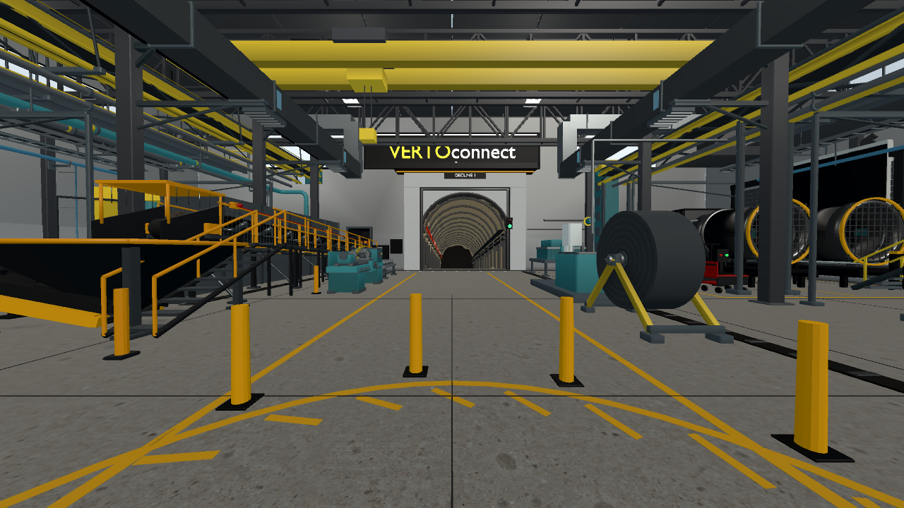
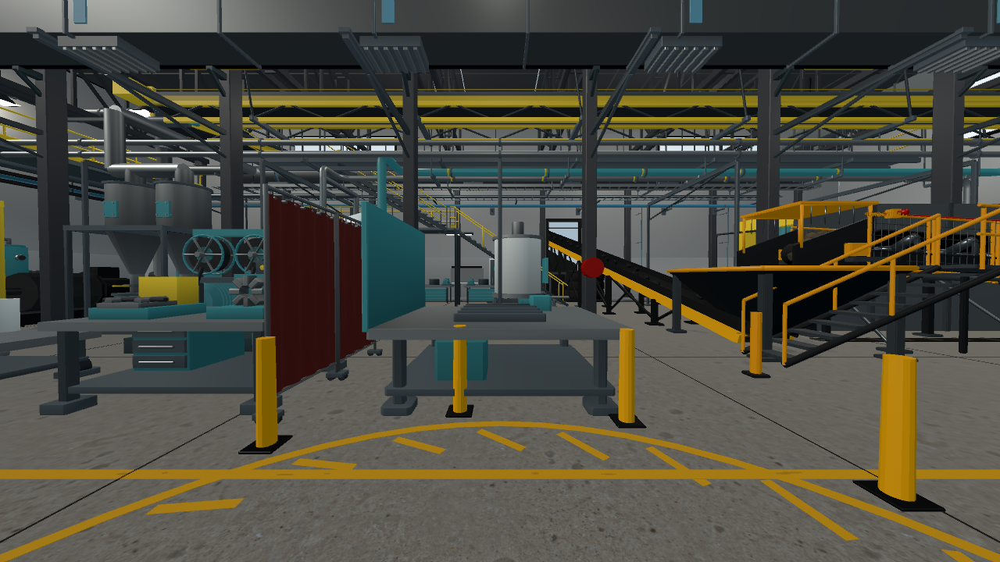
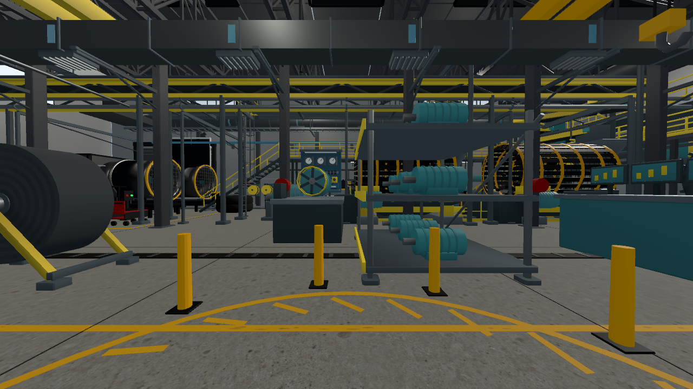
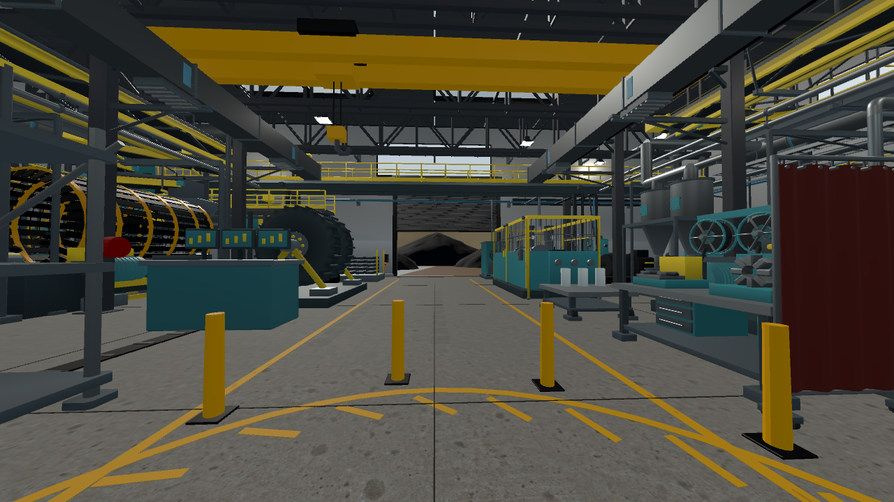
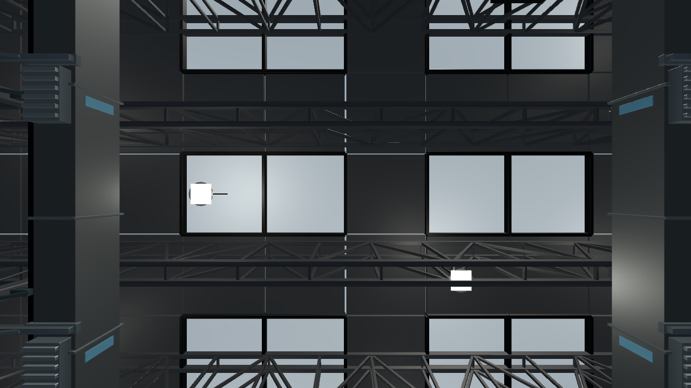
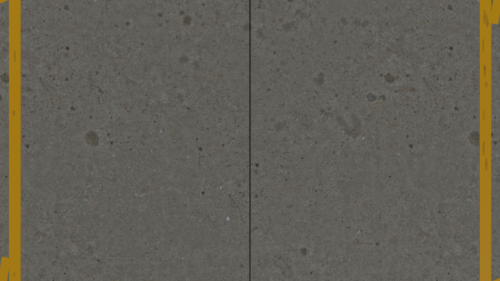
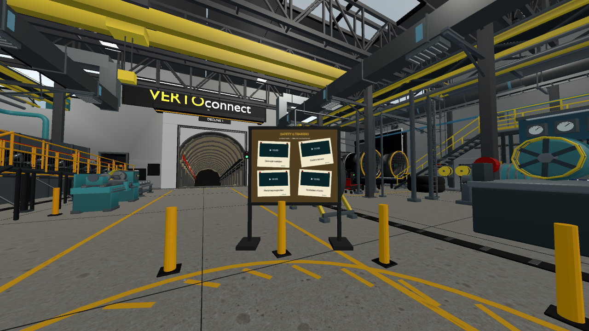

# Premium factory development review — 6 November 2026

Development branch: `feature/factory-density-performance`. Candidate: `1.0.1-beta.2`, Android code 39. This document records local review; a successful GitHub build and verified APK are separate delivery gates. No production promotion is authorised.

## Changes and composition

The expanded coal handling and maintenance facility retains thirteen added belt sections, guarded processing drums, ventilation branches, service machinery, overhead cranes, maintenance benches and a clear central viewing zone. This pass makes painted machinery dielectric, retains metallic shafts and bare steel, reduces skylight emission, removes the obsolete metal viewer inlay and its isolated baseplate, and parks the fabrication screens to open the left-hand view. Concrete wear, yellow route markings, packed rock textures and safety guarding remain.

The actual desktop application camera is at (0, 1.6, 0); XR continues to use the tracked headset pose. There is no new camera motion or locomotion. The forward portal remains the focal point. The rear view shows the service route and coal yard, the left exposes fabrication and transfer equipment, and the right presents motor storage and processing. Overhead structure, cable routes and cranes supply depth; the immediate floor remains clear. All ten exported-scene views were inspected, including machinery angles in addition to the six cardinal captures below.

| Forward | Left | Right |
| --- | --- | --- |
|  |  |  |

| Rear | Up | Down |
| --- | --- | --- |
|  |  |  |

These scene audit images omit runtime UI. The real application's board was separately captured and tested; it is to the right of the portal-facing view. Empty history produces a message rather than fake videos. Populated test history supplies actual fixture captions and all four selectable targets are reachable at approximately 4.03–4.05 m from the fixed camera. This fixture image does not prove native decoder thumbnails or headset readability:

[16-second machinery preview](premium-review/machinery-preview.mp4) — a fixed camera at the viewer origin, looking toward the transfer conveyor. Captured at 30 FPS in Godot movie mode; this is an animation illustration, not a performance measurement.

## Validation and limits

- Native dependency audit: nine packed file images, no linked libraries, included/built-in fonts; 6,522 source objects. Editable source and reproduction instructions are in `native-authoring.md`.
- Screen relocation: all 54 components retained; no external mesh intersections in the evaluated geometry check. The screens are parked beside an inactive fabrication bay, not removed from an active welding operation.
- Imported material and instancing test: 47 AO surfaces, 420 packed surfaces, 312 animated sources in 25 instance groups. GPU instance transforms match their animated sources across three sampled frames; original coal geometry remains intact.
- Machinery test: moving drums, pumps, test bench, cranes and press survive export; rigid drum geometry follows its animated parent; suspended scene motion freezes. No reported failures.
- Noticeboard tests: four distinct saved videos, photo exclusion, tilted corner selection, default-view bounds, disabled/empty states and the actual Main playback dispatch path pass. Native decoding is replaced at the test boundary.
- Public-source workflow: 63 tests pass, including rejection of modified native source, copies at unreviewed paths, missing provenance and assets exceeding the size cap.
- Conveyor regression: 30 stockpile rocks sampled over 40 seconds, with no off-belt or stagnant samples. Headset-handover logic and 18 immersive-lifecycle checks pass in the desktop test harness; physical proximity sensing remains a Quest check.

Current desktop Compatibility-renderer capture uses 1280×720 with 2× MSAA. Draw counts range from 41 overhead/downward to 134 forward; frame intervals in this paced run were approximately 9–11 ms. These are not Quest GPU timings and are not directly comparable with earlier unpaced profiles. Keep the existing batching and instancing; no hardware speedup is claimed.

A one-instance ObjectDB shutdown warning remains in the real Main playback test. It has not been identified as a runtime performance cause. Fixture video titles do not verify native frame extraction. Physical headset comfort, thin-rail shimmer, small-sign readability and sustained frame rate remain user checks.

## Quest review

Check the six directions and small natural head movements; confirm comfortable scale, portal/sign readability and poster targeting. Play real files to verify their titles/thumbnails, history updates and playback. Observe belt transfers, rotating machinery and crane movement, then check head-removal restart behaviour, factory audio and sustained turning performance. Report issues against this development build before any main merge.
